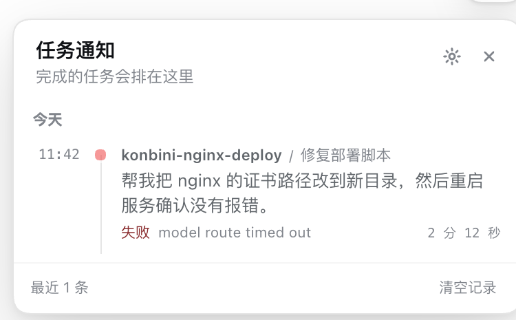
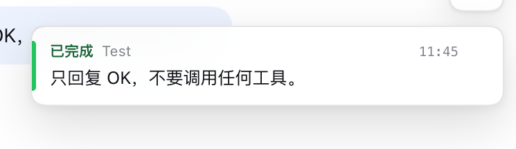

# dsh-task-notice

给 DeepSeek Harness 的任务完成通知：全局一只小铃铛，哪个项目、哪个会话、你问的什么、跑完没有，都在里面排好；点一下就回到那个会话。

同时开很多会话、项目目录一多，最容易发生的事就是任务其实早就跑完了，人还在等，或者干脆忘了回去看。这个插件把「完成」这件事从某个会话里拿出来，放到整个窗口都能看到的地方。





## 宣传视频

75 秒、1080p 的介绍片，配音和剪辑脚本都在 [`video/`](video/) 里：

- [视频 `video/out/dsh-task-notice-promo.mp4`](video/out/dsh-task-notice-promo.mp4)
- [字幕 `video/out/dsh-task-notice-promo.srt`](video/out/dsh-task-notice-promo.srt)
- [16:9 封面 `video/out/dsh-task-notice-cover-16x9.png`](video/out/dsh-task-notice-cover-16x9.png)
- [4:3 封面 `video/out/dsh-task-notice-cover-4x3.png`](video/out/dsh-task-notice-cover-4x3.png)
- [标题与简介 `video/out/publish-copy.md`](video/out/publish-copy.md)

## 能做什么

- **每个会话都能听见，不只是眼前这个。** Host 半边订阅所有 Session 的 `session/event`，不依赖当前打开的会话，所以后台项目跑完了也会提醒。
- **完成、失败、停止、阻塞分开说。** 失败会带上模型或工具返回的原因，停止会说明是谁停的。
- **两声短铃。** 用 Web Audio 合成，类似下载完成的那一下「叮咚」；完成是两声清脆的「叮咚」，失败/停止换成更低沉的两声。不打包音频文件。
- **全局小组件。** 右上角一只铃铛，有未读就带数字；点开是完成台账，按天分组，未读高亮。
- **拖到顺手的位置。** 按住铃铛、面板标题或完成卡片都能拖；靠近边角时面板会自动翻到有空间的一侧，位置记在本机，设置里一键复位。
- **完成卡片。** 新完成的任务从右上角滑出，写清项目、会话、问题和用时；鼠标停住不会自动消失，点卡片直接跳回会话。
- **需要你决定的任务单独提醒。** 模型发起 `ask_user_question` 时，铃铛变成琥珀色，面板和卡片会显示问题、分支选项和项目；点一下回到会话里做选择，AI 才能继续。这条提醒比普通完成通知优先，也不会在几秒后自动消失。
- **知道还有什么在跑。** 面板顶部会显示当前有几个任务正在运行。
- **可选系统通知。** 窗口不在前台时，可以再走一次系统通知（需要浏览器授权），点击同样跳回会话。
- **记得住。** 最近 100 条完成记录落在 `~/.dsh/task-notice/history.json`，重启后仍在；可以一键清空。
- **子代理默认不吵。** 子代理的会话默认不记录、不提醒，避免一个主任务派生出十几个通知；需要时可以配置打开。

## 安装

插件已经以 `link:` 方式装进当前桌面 profile：

```jsonc
// ~/.dsh/profiles/desktop/package.json
{
  "dsh": {
    "profile": {
      "bundles": ["@deepseek-ai/dsh-base", "@deepseek-ai/dsh-web-app", "dsh-local-usage", "dsh-local-send", "dsh-task-notice"]
    }
  },
  "dependencies": {
    "dsh-task-notice": "link:/Users/Admin/dsh-plugins/dsh-task-notice"
  }
}
```

如果换一台机器或换一个 profile，两种装法：

```bash
# 从 npm 安装
dsh plugin --profile desktop add dsh-task-notice

# 或从本地目录安装（开发时用这个）
dsh plugin --profile desktop add link:/绝对路径/dsh-plugins/dsh-task-notice
```

或者用界面里的「插件」页安装本地包，效果一样。装完如果窗口里还没出现铃铛，刷新一次窗口（⌘R）。

## 怎么用

1. 右上角出现铃铛，说明插件在工作。
2. 任务跑完时：
   - 会响一声（页面有过一次点击之后；浏览器不允许无手势自动播放）；
   - 右上角滑出完成卡片，写明项目、会话、问题和用时；
   - 铃铛上的未读数加一。
3. 点卡片、或者点铃铛后在台账里点某一行，会直接打开那个会话；这条通知也会从台账和未读数里收起。
4. 打开台账就算已读；也可以点「全部已读」。已读只改变高亮，点开过的条目才会从列表消失。
5. 台账底部「清空记录」需要点两次，只清这个列表，不动会话本身；清空后本机记住的「已点开」也会一并重置。
6. 想换个位置就按住铃铛、面板标题或卡片拖；松手后位置会记住。靠近底边时面板翻到铃铛上方，靠近左边时翻到铃铛右侧。

### 什么时候会提醒

默认规则：

- 完成的不是当前正在看的那个会话 → 提醒。
- 完成的是当前会话，但窗口在后台/失焦 → 提醒。
- 完成的就是眼前这个会话，窗口也有焦点 → 不打扰（答案已经在屏幕上了）。

想连眼前这个会话也提醒，打开设置里的「当前会话也提醒」。

### 设置

铃铛 → 齿轮：

| 设置 | 默认 | 说明 |
|---|---|---|
| 完成时播放提示音 | 开 | 关闭后只留视觉提醒 |
| 音量 | 60% | 0–100，旁边「试听」立即试一声 |
| 系统通知 | 关 | 窗口不在前台时，额外走系统通知；首次打开会请求权限 |
| 当前会话也提醒 | 关 | 默认不打扰正在看的会话 |
| 通知位置 | 右上角 | 拖动后出现「复位」；点一下回到默认位置 |

设置和位置都存在浏览器 `localStorage`，刷新后还在。焦点在铃铛上时，方向键可以微调 8 像素，按住 Shift 一次 32 像素。

## 配置

在 profile 的 `cordis.patch.yml` 里按 `id` 覆盖：

```yaml
- id: task-notice
  config:
    maxRecords: 200        # 保留多少条完成记录，默认 100，最大 500
    includeSubagents: true # 是否也记录子代理会话，默认 false
    persist: true          # 是否落盘，默认 true
```

## 数据与隐私

- 完成记录只存在本机：`~/.dsh/task-notice/history.json`，最多 100 条（按配置）。
- 记录里有会话 id、项目目录、会话标题、提问原文（截断到 500 字）、状态、起止时间和用时。
- Host 与页面之间走 Harness 自己的 `/api` Fetch 通道，带页面凭据；没有额外的网络监听端口。
- 提示音是本地合成的，不访问网络。

## 它怎么工作

```
┌─ DSH 主进程 ─────────────────────────────────────────────┐
│  Host 半边 (src/index.ts, src/ledger.ts)                 │
│   ├─ ctx.on('session/event')  所有会话的 turn/start·end   │
│   ├─ NoticeLedger            提问、标题、状态、用时折叠     │
│   ├─ history.json            最近 100 条，重启后还在       │
│   └─ GET /api/dsh-task-notice/state?since=&wait=          │
│        长轮询：有变化立刻返回，没变化最多挂 25 秒           │
└───────────────────────┬──────────────────────────────────┘
                        │ 同源 fetch（带凭据）
┌───────────────────────┴──────────────────────────────────┐
│  Client 半边 (src/client/)                               │
│   铃铛 · 完成台账 · 完成卡片 · 设置 · 合成提示音           │
└──────────────────────────────────────────────────────────┘
```

**为什么 Host 要管这件事。** 页面只收到当前会话的事件；如果通知只在当前会话里触发，那正好是唯一不需要通知的场景。所有会话都往主进程追加事件，所以「别的项目跑完了」只有主进程知道。

**为什么用长轮询而不是定时器。** 后台标签页会把 `setInterval` 节流到大约一分钟一次；通知晚一分钟到，人早就切走了。长轮询是一个被 Host 挂起的请求，返回时是普通网络回调，不受定时器节流影响。

**为什么记录按 `seq` 而不是按轮询版本判断新旧。** 会话标题经常在 `turn/end` 之后才生成；标题更新会让快照变版本，但那条记录不是新任务。记录自己带单调递增的 `seq`，只有它变大才是新完成。

**为什么标题可能晚到。** `session/title` 是独立的一次模型调用，通常比 `turn/end` 晚几秒；记录允许被原地更新，更新不改变 `seq`，所以不会重复提醒。

## 开发

前置：Node ≥ 20、pnpm，以及一份 DeepSeek Harness 源码 checkout（只用它的类型）。

```bash
cd ~/dsh-plugins/dsh-task-notice
pnpm install
DSH_SRC=/Users/openSource/deepseek-harness pnpm run link:host
pnpm test          # 57 项，Host 折叠 + 浏览器规则 + 拖动几何 + 待决定
pnpm typecheck
pnpm build         # lib/index.js + lib/client.js + lib/types
```

目录：

| 路径 | 作用 |
|---|---|
| `src/index.ts` | Host 入口：订阅、落盘、两条路由 |
| `src/ledger.ts` | 纯折叠：会话事件 → 完成记录；可单测 |
| `src/types.ts` | Host/浏览器共享的 JSON 契约 |
| `src/client/state.ts` | 长轮询循环、新记录判定 |
| `src/client/model.ts` | 未读、是否打扰、按天分组、标题是否重复 |
| `src/client/NoticeWidget.tsx` | 铃铛、台账、卡片、设置、拖动 |
| `src/client/position.ts` | 位置存储、边界约束、面板翻转方向 |
| `src/client/sound.ts` | 两声铃的合成与解锁 |
| `src/client/styles.ts` | 全部样式，只用产品 token |

开发时的自测：写一条任务进去，等它跑完，看卡片是否出现、点击是否回到会话；`~/.dsh/task-notice/history.json` 里应出现对应记录。改完 `lib/` 后，客户端资源会按文件时间戳重新发版，刷新窗口即可。

## 已知限制

- 通知需要页面开着；页面关掉时 Host 仍会记录，但没有声音和卡片。
- 浏览器要求先有一次点击才允许播放声音，这是自动播放策略，不是插件能绕过的。
- 多个窗口会各自提醒、各自记「已读」和「已点开」；目前没有跨窗口同步这些状态。
- 只按「一轮对话结束」提醒。一次提问如果被拆成多轮（排队消息、继续执行），会按实际轮次各提醒一次。
- 系统通知依赖浏览器/Electron 的 `Notification` 实现，权限被拒时只在设置里说明，不反复弹窗。
- 待决定提醒来自 Host 正在观察的会话事件，只存在内存；插件启动前已经挂着的问题不会补发。
